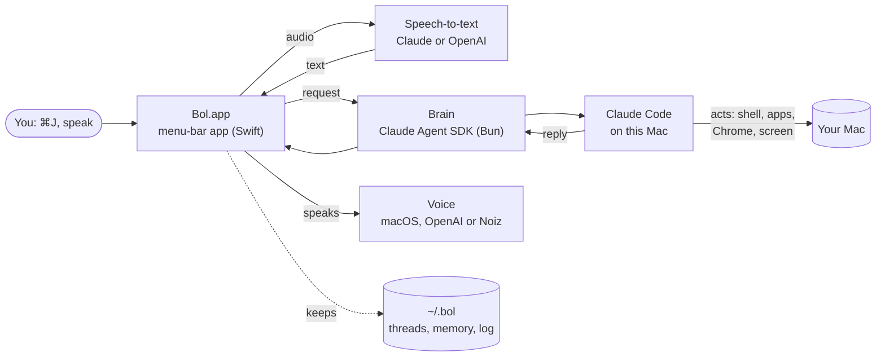

# Bol

**Talk to your Mac. Claude does the work.** Press ⌘J, say what you need, and Claude Code does it on your
Mac, then tells you when it's done. Runs on your Claude subscription.



In plain terms: you talk, Bol turns your voice into text, hands it to the Claude Code installed on your Mac,
which does the job, and Bol reads the short answer back. Everything it keeps stays in `~/.bol`.

> [!WARNING]
> Bol runs Claude Code with **permission checks off**: it acts on your Mac without asking first. It's told to
> move deleted files to the Trash, but that's an instruction, not a lock.

> [!NOTE]
> Listening and plan usage use Anthropic endpoints that aren't public APIs (the ones behind Claude Code's
> `/voice` and `/usage`). If they break, Bol says so and can listen with OpenAI instead. Not affiliated
> with Anthropic.

## Install (from source)

1. Install [Claude Code](https://claude.com/claude-code) and sign in with Claude Pro or Max.
2. Install the build tools: [Bun](https://bun.sh) (`brew install bun`) and Xcode or the Swift command-line tools.
3. Build, install to /Applications and launch:

   ```sh
   ./build.sh --install --run
   ```

4. Follow the two-minute setup, then press **⌘J** anywhere and talk.

macOS 13+, Apple silicon or Intel.

## Updates

This build doesn't check for updates or contact any update server (`Constants.updateFeedURL` is `nil`). To
update, pull and rebuild:

```sh
git pull && ./build.sh --install --run
```

To ship signed, self-updating releases instead, see [Release](#release).

## What it does

- **Talk:** ⌘J, speak, Enter to send, Esc to stop. Replies are spoken (macOS, OpenAI or Noiz AI voices).
- **Work:** every Claude Code tool, MCP servers, Claude in Chrome, and its own computer use.
- **Models:** Claude Opus 5.5 or Fable 5.2 only, never below medium effort.
- **Tasks:** long jobs run in the background; Bol comes back when they're done.
- **Dictation:** hold fn in any app, speak, let go to paste. Optional.
- **Threads and memory:** every conversation and step, kept in `~/.bol`.

## Develop

```sh
./build.sh --install --run   # build, copy to /Applications, launch
./test.sh                    # type check, formatting, Swift tests
```

For permissions that survive rebuilds, create a code-signing certificate named "Bol Local Signing" in Keychain
Access (or set `BOL_LOCAL_IDENTITY` to another one). Without it, builds are signed ad hoc and macOS may ask for
permissions again after each rebuild.

```
src/swift/        the menu-bar app (app, audio, speech-to-text, text-to-speech, hud, dictation, threads, settings…)
src/typescript/   the brain: Claude Agent SDK, compiled to one executable
tests/swift/      Swift Testing suites
website/          landing page, terms and privacy, and the update feed (latest.json), a Cloudflare Worker
assets/           app icon, entitlements, DMG window design
```

Speech-to-text and voice providers are plugins: one file each under `providers/`.

## Release

Needs an Apple Developer ID, your own domain on Cloudflare, and an R2 bucket for downloads. `website/` and the
DMG background (`assets/dmg/`) still carry the original agentbol.com domain and contact details: replace them
with yours before deploying.

```sh
export BOL_SIGN_IDENTITY="Developer ID Application: <Name> (<TEAM ID>)"
export BOL_SITE=example.com BOL_DOWNLOAD_HOST=https://dl.example.com BOL_R2_BUCKET=bol-releases
./release.sh 0.2.0 5 "What's new."
```

Set `Constants.updateFeedURL` to `https://$BOL_SITE/latest.json` first. The script builds a universal app,
signs and notarizes it and its DMG, uploads it, and updates the feed and `/download`. The build number must go
up each time. One-time setup is at the top of the script.

## Contributing

Pull requests welcome. Run `./test.sh` first; commits use [Conventional Commits](https://www.conventionalcommits.org).

## Credits and license

Maintained by [snktcodes](https://github.com/snktcodes). Based on [Bol](https://github.com/mehulmpt/bol) by
Mehul Mohan.

[MIT](LICENSE). Claude is a trademark of Anthropic.
